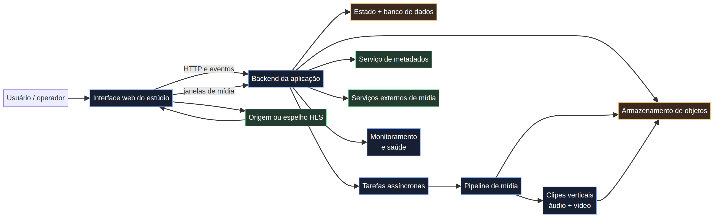

# KakashiHub
## Plataforma web para captura, edição e publicação de clipes de transmissões ao vivo

**Documentação técnica para apresentação acadêmica**  
**Curso:** Engenharia de Software  
**Versão pública para apresentação:** novembro de 2026

> Este documento apresenta um estudo de caso baseado em um produto real com usuários. Informações internas de infraestrutura, autenticação, repositório, configurações privadas, identificadores de implantação e dados operacionais foram deliberadamente omitidas.

---

## 1. Resumo

O KakashiHub é uma plataforma web para transformar transmissões ao vivo e vídeos em clipes verticais prontos para publicação. O sistema permite acompanhar fontes de conteúdo, capturar janelas de áudio e vídeo, processar mídia, selecionar trechos relevantes, aplicar enquadramento e gerar arquivos adequados para redes sociais.

O projeto nasceu de uma necessidade real: reduzir o trabalho manual de acompanhar transmissões longas, localizar momentos interessantes, recortar o material e preparar publicações. Além do processamento de vídeos comuns, a plataforma precisa lidar com a complexidade de transmissões ao vivo, formadas por pequenos segmentos HLS que são atualizados continuamente.

Este estudo de caso envolve requisitos funcionais e não funcionais, integração com serviços externos, processamento assíncrono, persistência, limites de infraestrutura, observabilidade, segurança e manutenção evolutiva de um sistema que atende público real.

### Palavras-chave

`full-stack`, `React`, `Node.js`, `Express`, `FFmpeg`, `HLS`, `live streaming`, `processamento assíncrono`, `persistência`, `observabilidade`.

---

## 2. Motivação e problema de negócio

Criadores e operadores de canais precisam acompanhar transmissões longas e transformar momentos relevantes em vídeos curtos. Fazer isso manualmente exige permanecer atento à transmissão, identificar o momento certo, encontrar o intervalo correto, recortar áudio e vídeo, adaptar o enquadramento e gerar uma saída de qualidade.

Esse processo é repetitivo, demorado e sujeito a erros. Um pequeno deslocamento entre áudio e vídeo já compromete a qualidade percebida pelo público. O KakashiHub busca centralizar esse fluxo em um estúdio web, automatizando tarefas repetitivas sem retirar do operador o controle editorial.

### Objetivo geral

Desenvolver uma plataforma web capaz de capturar, processar e organizar clipes de vídeos e transmissões ao vivo.

### Objetivos específicos

- cadastrar fontes de conteúdo;
- acompanhar o status de transmissões;
- capturar segmentos de uma live usando HLS;
- preservar a relação entre áudio e vídeo;
- processar vídeos com FFmpeg;
- gerar vídeos verticais em resoluções configuráveis;
- organizar clipes, tarefas e atividades;
- manter o sistema observável e recuperável;
- permitir evolução incremental sem interromper a captura.

---

## 3. Escopo funcional

| Módulo | Responsabilidade |
|---|---|
| Estúdio | Interface para acompanhar fontes, lives e tarefas |
| Fontes | Cadastro e gerenciamento de canais e plataformas |
| Captura | Recepção de vídeos e janelas de mídia de lives |
| Processamento | Cortes, escala, composição vertical e exportação |
| Seleção | Organização e revisão dos clipes produzidos |
| Uploads | Entrada de arquivos para processamento |
| Publicação | Preparação de conteúdo para distribuição |
| Monitoramento | Exibição de status, saúde e atividades |

O projeto não depende da ideia de que uma única API externa resolverá o fluxo completo. Cada provedor possui limitações próprias, e a arquitetura precisa tratar indisponibilidade, URLs temporárias, diferenças de autenticação e bloqueios de rede.

---

## 4. Arquitetura geral

O KakashiHub utiliza uma arquitetura web full-stack com uma interface de estúdio e um backend responsável por API, persistência, tarefas e processamento de mídia.



### Visão simplificada

```text
Usuário no navegador
        |
        v
Interface web do estúdio
        |
        | requisições HTTP e janelas de mídia
        v
Backend da aplicação
   |        |          |
   |        |          +--> banco de dados e estado
   |        +-------------> armazenamento de mídia
   +----------------------> tarefas e processamento FFmpeg
        |
        +--> serviços de metadados
        +--> provedores ou espelhos de transmissão
```

### Princípios arquiteturais

- **Separação de responsabilidades:** interface, API, persistência e processamento possuem papéis distintos.
- **Processamento assíncrono:** tarefas longas não devem bloquear a requisição do navegador.
- **Tolerância a falhas externas:** serviços de terceiros podem falhar ou mudar de comportamento.
- **Configuração por ambiente:** credenciais e parâmetros privados não ficam no código-fonte.
- **Evolução incremental:** componentes podem ser atualizados sem reescrever o sistema inteiro.
- **Observabilidade:** o operador precisa saber se a aplicação, o armazenamento e a captura estão funcionando.

---

## 5. Fluxo de uma transmissão ao vivo

Capturar uma live é diferente de baixar um vídeo já finalizado. A transmissão é formada por uma playlist HLS que aponta para segmentos pequenos e recentes.

### 5.1 Detecção

Um serviço de metadados confirma se a transmissão está no ar e fornece informações como título, canal e imagem. Esse serviço não precisa ser o mesmo que fornece os segmentos de áudio e vídeo.

A aplicação seleciona um modo de captura conforme a origem:

- **Captura pelo navegador:** útil quando a origem funciona melhor na rede do operador do que em um servidor de datacenter.
- **Captura pelo servidor:** útil quando o backend consegue acessar a transmissão diretamente.

### 5.2 Resolução do HLS

A aplicação obtém uma configuração de captura e consulta a origem para receber uma URL HLS temporária. A URL aponta para playlists de vídeo e áudio e pode expirar, portanto não deve ser tratada como um endereço permanente.

### 5.3 Captura por janelas

Em vez de manter um arquivo infinito, o sistema trabalha com janelas recentes:

1. localizar a playlist atual;
2. identificar as trilhas de vídeo e áudio;
3. selecionar segmentos recentes;
4. baixar os segmentos;
5. montar uma janela de cada trilha;
6. enviar a janela ao backend;
7. repetir enquanto a transmissão estiver sendo monitorada.

Essa estratégia limita o volume de dados em memória e permite detectar quando o monitoramento deixou de receber conteúdo.

### 5.4 Mux e processamento

O backend recebe as trilhas e utiliza FFmpeg para combiná-las. O processamento deve preservar os streams e suas marcações temporais, evitando transformações desnecessárias.

O cuidado com timestamps é importante: uma mudança aparentemente pequena na seleção de segmentos pode afetar a sincronização ou interromper o fluxo da live. Por isso, melhorias de sincronização devem ser isoladas, testadas e avaliadas separadamente.

### 5.5 Encerramento

A captura termina quando o operador interrompe o monitoramento ou quando a aplicação não recebe janelas suficientes dentro do intervalo esperado. O sistema registra uma condição compreensível para que o operador consiga decidir se deve tentar novamente.

---

## 6. Pipeline de mídia

O pipeline de mídia combina regras de negócio, execução de processos externos e tratamento de arquivos temporários.

### Etapas típicas

1. **Entrada:** URL, arquivo ou janela de transmissão.
2. **Resolução:** obtenção da mídia e de seus metadados.
3. **Preparação:** validação e criação de arquivos temporários.
4. **Análise:** duração, áudio, frames e enquadramento.
5. **Processamento:** corte, escala e composição vertical.
6. **Saída:** arquivo final e registro do clipe.
7. **Persistência:** armazenamento do arquivo e do estado.
8. **Acompanhamento:** atualização da tarefa e do histórico.

### Resoluções e recursos

O produto pode trabalhar com diferentes perfis de saída vertical. Em ambientes com pouca memória, o sistema pode adotar um perfil mais leve para reduzir o risco de interrupção do processo.

Essa decisão apresenta um trade-off clássico: qualidade máxima não é sempre a melhor escolha operacional. A plataforma precisa produzir uma saída adequada sem comprometer a disponibilidade.

### Áudio e vídeo

O áudio deve ser tratado como parte inseparável do clipe. Uma transformação de vídeo não pode descartar ou deslocar a trilha de áudio por acidente.

Durante a manutenção do projeto, uma tentativa de alterar a seleção temporal de segmentos foi revertida porque interferiu no funcionamento da live. A solução posterior foi localizada em uma camada de consistência do estado, sem alterar a lógica de captura. Esse episódio reforçou a importância de separar mudanças de sincronização de mudanças de estabilidade.

---

## 7. Persistência e estado

A aplicação mantém informações sobre fontes, clipes, tarefas, configurações, projeto e histórico de atividades. Os arquivos de mídia são tratados separadamente do estado textual, usando armazenamento apropriado para objetos grandes.

### Estado compatível com versões anteriores

Em um sistema em evolução, não se pode presumir que qualquer estado persistido no passado possua todas as propriedades da versão atual. Uma coleção ausente deve ser interpretada de maneira segura:

```js
const clips = Array.isArray(state.clips) ? state.clips : []
const previous = clips.filter((clip) => clip.sourceId === sourceId)
```

Esse cuidado evita que a aplicação falhe ao carregar estados antigos ou incompletos.

### Estratégia de recuperação

A aplicação deve:

- inicializar coleções ausentes com valores seguros;
- validar dados antes de aplicar filtros ou transformações;
- registrar falhas sem expor credenciais;
- manter tarefas e fontes em estados compreensíveis;
- permitir uma nova tentativa sem corromper o estado anterior.

---

## 8. Interface entre componentes

A comunicação ocorre por uma API HTTP. A interface consulta estado, solicita configurações, envia arquivos ou janelas de mídia e acompanha tarefas.

As principais categorias de operações são:

| Categoria | Finalidade |
|---|---|
| Saúde | Verificar disponibilidade da aplicação e dependências |
| Estado | Consultar fontes, clipes, tarefas e atividades |
| Captura | Obter configuração e enviar janelas da live |
| Projeto | Atualizar configurações e identidade visual |
| Mídia | Enviar, processar e recuperar arquivos autorizados |
| Monitoramento | Consultar status e eventos relevantes |

A API de saúde é especialmente importante em produção porque permite diferenciar uma falha de código de uma indisponibilidade de banco, armazenamento ou provedor externo.

---

## 9. Segurança e proteção operacional

Informações de autenticação, chaves de API, cookies e configurações privadas devem permanecer fora da documentação pública e do código-fonte. No projeto, esses valores são tratados como configuração de ambiente.

Outras medidas importantes incluem:

- limitar tamanho e tipos de arquivos recebidos;
- sanitizar mensagens de erro;
- evitar credenciais em logs;
- controlar processos externos;
- validar URLs e parâmetros;
- proteger arquivos de mídia privados;
- diferenciar endpoints de saúde de operações administrativas;
- registrar apenas informações necessárias para diagnóstico.

Segurança não é apenas autenticação. Também envolve disponibilidade, controle de recursos, proteção de dados e capacidade de recuperar o sistema após uma falha.

---

## 10. Implantação e operação

O sistema é implantado em serviços de nuvem com build automatizado e verificação de saúde. A interface e o backend podem evoluir de forma independente, desde que seus contratos de comunicação sejam preservados.

A aplicação precisa de um ambiente capaz de executar JavaScript no servidor, processamento de vídeo e armazenamento persistente ou externo. O uso de containers ajuda a padronizar dependências como Node.js, Python e FFmpeg.

### Práticas operacionais

- verificar a saúde após cada implantação;
- associar o comportamento observado à versão publicada;
- testar uma nova transmissão depois de mudanças na captura;
- monitorar consumo de memória e duração das tarefas;
- manter credenciais somente no ambiente de execução;
- separar alterações de infraestrutura de alterações de sincronização.

---

## 11. Incidente técnico estudado

O problema inicial percebido era áudio atrasado ou adiantado em determinados clipes. A investigação levou a uma tentativa de modificar a seleção de segmentos HLS e a ancoragem temporal. Como a transmissão deixou de funcionar após essa mudança, a alteração foi revertida para preservar o caminho crítico da live.

A análise posterior encontrou uma falha diferente e concreta: o pipeline assumia que uma coleção de clipes sempre existiria no estado carregado. Em uma situação com estado antigo ou incompleto, o código tentava filtrar uma coleção inexistente.

### Correção aplicada

A correção adotou uma abordagem defensiva:

- tratar a coleção ausente como vazia;
- proteger o processamento da janela ao vivo;
- proteger a inicialização e a contagem de clipes anteriores;
- não modificar a seleção HLS;
- não modificar timestamps de áudio ou vídeo;
- validar sintaxe e diferenças antes da implantação;
- iniciar uma nova live após a publicação para confirmar o comportamento.

### Aprendizados

1. **Preservar o caminho crítico:** em uma live com público, disponibilidade vem antes de uma melhoria experimental.
2. **Isolar mudanças de alto risco:** sincronização temporal deve ter mudança e testes próprios.
3. **Investigar o erro observado:** a mensagem registrada orientou a busca pela causa real.
4. **Tratar dados persistidos como não confiáveis:** versões antigas podem não possuir todas as chaves atuais.
5. **Validar em produção com segurança:** uma nova execução deve ser observada após a implantação.

---

## 12. Estratégia de testes

### Validações técnicas

- checagem de sintaxe;
- verificação de alterações no código;
- build da interface;
- inicialização do servidor em ambiente de teste;
- verificação do endpoint de saúde;
- teste de uma nova live após a implantação;
- confirmação de que uma falha antiga não reaparece.

### Cenários recomendados

| Cenário | Resultado esperado |
|---|---|
| Estado sem coleção de clipes | A aplicação inicializa uma coleção vazia |
| Live disponível | O navegador envia janelas e o backend processa |
| Origem indisponível | O sistema registra uma mensagem compreensível |
| Playlist sem áudio | A janela é rejeitada sem corromper o estado |
| Navegador fechado | O monitoramento encerra com controle |
| Pouca memória | O perfil leve evita processamento excessivo |
| Armazenamento indisponível | A saúde informa a dependência com problema |
| Arquivo acima do limite | A requisição é rejeitada antes do processamento |

### Evoluções de teste

- testes de contrato da API;
- playlists HLS sintéticas;
- arquivos com marcadores de áudio conhecidos;
- métricas de atraso entre captura e clipe disponível;
- testes de carga para várias lives;
- testes de recuperação de tarefas interrompidas.

---

## 13. Requisitos não funcionais

| Requisito | Aplicação no projeto |
|---|---|
| Disponibilidade | Health check, retry e caminhos alternativos |
| Desempenho | Janelas de captura e processamento assíncrono |
| Confiabilidade | Estado persistido e validações defensivas |
| Manutenibilidade | Separação entre interface, API e pipeline |
| Segurança | Segredos por ambiente e limites de upload |
| Escalabilidade | Serviços separados e armazenamento externo |
| Observabilidade | Status, tarefas, atividades e logs sanitizados |
| Portabilidade | Container e dependências reproduzíveis |

---

## 14. Decisões e trade-offs

### Captura no navegador versus servidor

A captura no navegador pode funcionar melhor quando a origem trata redes de datacenter de maneira diferente. O servidor, por outro lado, oferece maior controle operacional.

**Benefício do navegador:** acesso a uma rede e a uma origem que podem ser mais favoráveis.  
**Custo:** a aba precisa permanecer aberta e depende do dispositivo do operador.

### FFmpeg local versus serviço externo

O FFmpeg local oferece controle sobre codecs, cortes e composição.

**Benefício:** flexibilidade e menor dependência de uma API de vídeo.  
**Custo:** consumo de CPU e memória e necessidade de tratar processos externos.

### Ambiente econômico versus qualidade máxima

Um ambiente de baixo custo ajuda a validar o produto real, mas exige perfis de processamento compatíveis com os recursos disponíveis.

**Benefício:** custo operacional menor.  
**Custo:** limitação de concorrência e necessidade de otimização.

### Estado simples versus fila especializada

Um estado com tarefas é adequado para uma primeira escala. Volumes maiores exigirão uma fila persistente, workers independentes, retry e controle de concorrência.

---

## 15. Roadmap técnico

### Curto prazo

- ampliar testes do ciclo de vida da live;
- adicionar métricas de captura e processamento;
- registrar duração e tamanho das janelas;
- criar uma tela de diagnóstico para operadores;
- documentar contratos de integração.

### Médio prazo

- mover tarefas longas para workers dedicados;
- adicionar fila persistente com retry e backoff;
- criar fixtures HLS para testes de sincronização;
- separar ainda mais domínio, infraestrutura e adaptadores externos;
- adicionar controle de concorrência por fonte.

### Longo prazo

- suportar múltiplas regiões e provedores de armazenamento;
- adotar logs estruturados, métricas e traces;
- selecionar momentos usando sinais de áudio, chat e eventos;
- oferecer publicação agendada com confirmação e auditoria;
- evoluir para arquitetura orientada a eventos quando o volume justificar.

---

## 16. Conclusão

O KakashiHub demonstra como conceitos de Engenharia de Software aparecem em um produto real: levantamento de requisitos, modularização, integração com APIs, processamento assíncrono, tolerância a falhas, segurança, implantação contínua, observabilidade e manutenção evolutiva.

O principal aprendizado não é apenas capturar um stream HLS. É realizar mudanças em um sistema vivo sem comprometer o caminho crítico. Ao perceber que uma primeira alteração de sincronização afetava a operação, ela foi revertida. Em seguida, a investigação encontrou uma falha de consistência do estado, que foi corrigida de forma localizada e defensiva.

Esse ciclo — observar, formular hipótese, isolar a mudança, validar, publicar e medir — é uma prática central de Engenharia de Software aplicada a sistemas que precisam continuar funcionando para usuários reais.

---

## Perguntas para discussão em sala

1. Em que momento a captura no navegador deixa de ser adequada e passa a exigir um worker especializado?
2. Como testar sincronização de áudio e vídeo de forma automatizada?
3. Quais propriedades deveriam ser garantidas por um schema de estado versionado?
4. Que métricas indicariam a necessidade de uma infraestrutura maior?
5. Como transformar o processamento atual em uma arquitetura orientada a eventos?
6. Quais riscos existem ao depender de provedores externos em um produto com público real?
